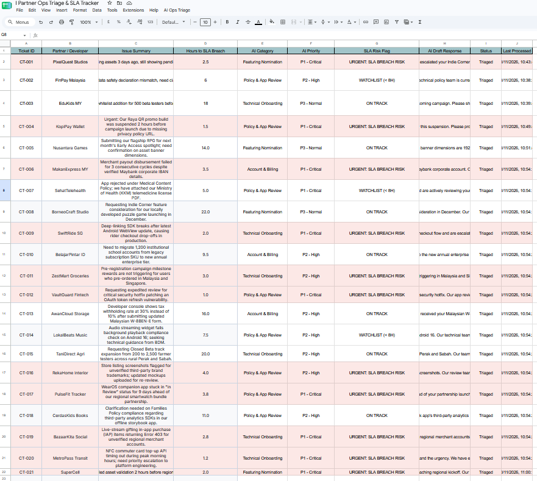

# AI Partner Ticket Triage & SLA Escalation Tracker

An automated Partner & Marketplace Operations triage workflow built inside **Google Sheets** using **Google Apps Script** and the **Gemini API** (`gemini-3.5-flash-lite`).

## Problem Solved
High-volume Partner and Developer Operations teams spend significant manual effort sorting unstructured support queues, identifying tickets nearing SLA breach, and drafting repetitive first-response updates. This tool automates classification, SLA escalation flagging, and initial partner reply drafting in one click directly inside Google Sheets.

## Key Capabilities
- **AI Ticket Classification:** Categorizes incoming partner tickets into standardized operational queues (`Featuring Nomination`, `Policy & App Review`, `Technical Onboarding`, `Account & Billing`) with `P1–P3` priority assignment.
- **Deterministic SLA Breach Guardrails:** Evaluates remaining hours to breach using hard threshold rules (`≤ 4.0 hrs` → `URGENT: SLA BREACH RISK` with automatic red row highlighting; `≤ 8.0 hrs` → `WATCHLIST (< 8H)`).
- **Automated Partner Response Drafting:** Generates a context-aware, 2-sentence partner reply tailored to the ticket's issue and next escalation step.
- **Parallel Batch Processing:** Uses `UrlFetchApp.fetchAll()` (batching 5 rows concurrently) and `SpreadsheetApp.flush()` to process 20+ tickets in seconds while skipping already-triaged rows.

## Setup Instructions
1. Create a Google Sheet with a tab named `Ticket_Queue` and headers in row 1:
   `Ticket ID | Partner / Developer | Issue Summary | Hours to SLA Breach | AI Category | AI Priority | SLA Risk Flag | AI Draft Response | Status | Last Processed`
2. Open **Extensions > Apps Script**, paste the contents of `Code.gs`, and insert your Google AI Studio API key.
3. Reload the Google Sheet and run **AI Ops Triage > Run AI Ticket Triage** from the top me
